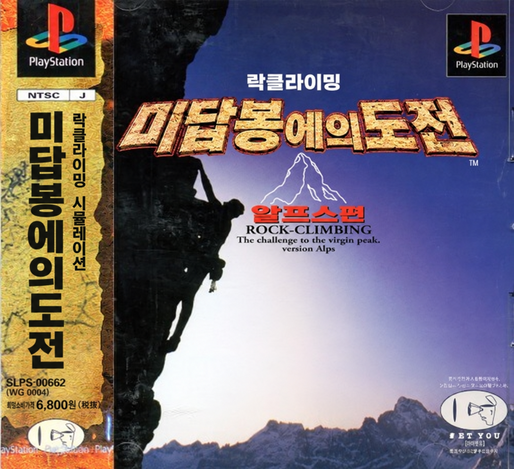

<p align="center"></p>

# 락클라이밍 미답봉에의 도전 알프스 편 한글화

플레이스테이션용 『ロッククライミング 未踏峰への挑戦 アルプス編』(일본판, SLPS-00662, ⓒ 위넷)의 한글 패치 제작 프로젝트입니다.

> **현재 상태: 초기 조사·대표 PoC 완료 (배포본 없음)**
> 게임 글꼴과 문자 코드를 해독했고, 데이터베이스 화면 한 줄을 한국어로 표시하는 데 성공했습니다. 아직 번역과 패치 빌드 도구가 없어 플레이할 수 있는 패치는 없습니다.

## 진행 상황

| 항목 | 상태 |
|---|---|
| 디스크 구조·재구성 | 완료. 데이터 트랙 파일을 제자리에서 바꾸고, 무변경 재구성이 원본과 바이트 단위로 일치 |
| 글꼴·문자 코드 | 12×12 글꼴 1,348자, 1·2바이트 코드, 글자별 진행폭 표(원작의 2바이트 폭 k+1 버그 포함) 해독 |
| 한글 표시 PoC | 완료. 데이터베이스 설명문 한 줄 한국어 표시 |
| 문자표 | 완료. 1,348칸 전부 (문맥 교정 30칸, 미검증 5칸) |
| 문자열 추출 | 진행 전. 메뉴 모듈 포인터 80% 확인, 양은 추정 약 650문자열·2만 자 |
| 번역 | 진행 전 |
| 그림 글자 | 일본어 그림만 한글화(D1). 위치 조사 전 |
| 이름 입력 | 한글 입력 표로 교체(D2). 조사 전 |

자세한 조사 결과와 근거는 [`docs/survey.md`](docs/survey.md), 결정 사항은 [`docs/decisions.md`](docs/decisions.md)에 있습니다.

## 지원 원본

정당하게 소유한 일본판 디스크 이미지(bin/cue 22트랙, 트랙 1 `MODE2/2352`, 트랙 2–22 CD-DA)만 지원합니다. 원본 이미지와 게임 데이터는 이 저장소에 없으며 배포하지 않습니다.

| 항목 | 값 |
|---|---|
| 트랙 1 크기 | 150,744,384 바이트 |
| 트랙 1 SHA-256 | `86918cf6ae389bd0ef5ab264a0f172d8fcb9d70026a2f25cb7ec3fa9d4b9c6d8` |
| 트랙 1 MD5 | `f4f8bbfd2913d2c92ecc983193aacf29` |

패치는 트랙 1만 바꿉니다. 오디오 트랙은 원본을 그대로 씁니다.

## 개발 환경

Python 3와 numpy가 필요합니다. 한글 글꼴은 [Galmuri](https://github.com/quiple/galmuri)의 `Galmuri11.bdf`를 씁니다(기본 경로 `../galmuri/`, 또는 환경 변수 `GALMURI11_BDF`).

### 파일 추출 (분석용)

```sh
cd tools
python3 extract.py "../original/<원본> (Track 01).bin" ../work/files
```

### PoC 빌드

```sh
cd tools
python3 poc_db.py --src "../original/<원본> (Track 01).bin" --cue "../original/<원본>.cue" \
  --galmuri ../../galmuri/Galmuri11.bdf --out ../build/poc_db.bin
```

`build/poc_db.cue`가 함께 생기며, 오디오 트랙은 `original/`의 파일을 가리킵니다. 원본 해시가 다르거나 출력 경로가 원본과 같으면 빌드를 거부합니다.

### 테스트

```sh
python3 -m pytest -q tests/
```

원본 데이터가 필요한 테스트는 `original/`에 원본 트랙, `work/files/`에 추출 파일이 있을 때만 실행됩니다.

## 구조

| 경로 | 내용 |
|---|---|
| `tools/iso.py`, `tools/cdsector.py` | 트랙 1 ISO 9660 파일 제자리 교체, Mode 2 Form 1 EDC/ECC |
| `tools/textcodec.py` | 게임 문자 코드 ↔ 글리프 번호 |
| `tools/kfont.py` | BDF → 게임 12×12 글리프 |
| `tools/extract.py` | 데이터 트랙 파일 추출 |
| `tools/poc_db.py` | 대표 PoC 빌더 |
| `tools/charmap.py`, `tables/charmap.tsv` | 글리프 번호 → 문자표 (판독 상태 포함) |
| `docs/` | 조사 기록, 결정 기록 |

디스크 도구는 같은 제작자의 [바람의 검심 한글화](https://github.com/stPark-dev/Kenshin_Juuyuushi_Inbou_Hen_Korean) 프로젝트에서 가져와 이 디스크에 맞게 고쳤습니다.
